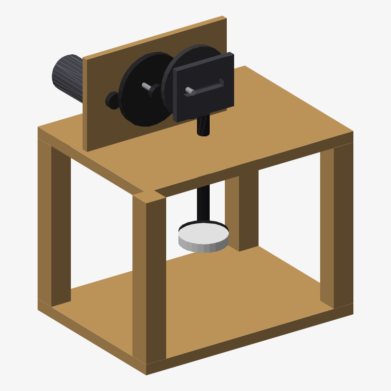
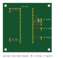
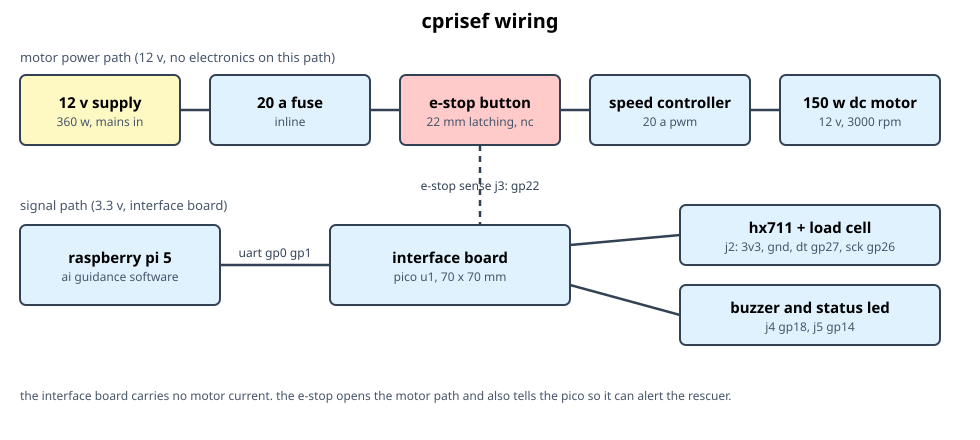

# Journal

## Journal 1: the problem and the mechanism

I started by writing down what CPRISEF has to do. Rescuers get tired in about two minutes and their compressions drift, so I want a machine that holds a steady 120 compressions a minute at about 50 mm depth. To turn a motor's spin into an up-and-down push I chose a scotch yoke, which gives a straight stroke from a crank and a slot. A 25 mm crank radius gives the 50 mm stroke.

## Journal 2: modeling the rig in CadQuery

I wrote the whole rig as Python with CadQuery, so every dimension is a parameter in cprisef.py. It builds the frame, the motor, the shafts, the crank, the yoke and the pad. If I change the stroke or the crank radius, the model rebuilds, which is why I used code instead of clicking through a CAD program.

## Journal 3: the gearbox and the STEP files

The motor spins at 3000 rpm and I need 120 compressions a minute, so the gearbox has to cut the speed 25 to 1. I used two stages of module 1.5 spur gears, with a 16-tooth pinion driving an 80-tooth gear in each stage. I exported the assembly as cprisef_rig.step and wrote export_parts.py to save each of the 14 parts as its own STEP file. Then I checked that every file opens and holds valid solids.

## Journal 4: the interface PCB

The motor runs from an off-the-shelf speed controller, so my board carries no motor current. It is a 70 by 70 mm two-layer board that connects a Raspberry Pi Pico to the HX711 load cell amplifier, an emergency stop input, a buzzer, a status LED and a UART link to the Raspberry Pi 5. It also has a 100 nF capacitor for the HX711 supply and four mounting holes. I generate the KiCad files and the gerbers from a script, pcb/make_pcb.py, so the pin assignments live in one place.

## Journal 5: running KiCad checks and the ground fill bug

I opened the board in KiCad 7 and ran the design rule check. It reported 13 unconnected ground pads. The cause was that the ground copper pour was drawn on the board but not filled. After I filled it, the check showed 0 errors. The only warnings left are about footprints being embedded in the file instead of coming from a library, and those do not affect the board. I also confirmed the pour is already drawn in the bottom copper gerber, so fabrication is not affected.

## Journal 6: firmware, the BOM and printing the gears

The firmware in firmware/main.py runs on the Pico. It reads the load cell, counts compressions, checks the rate against the 100 to 120 per minute window, sounds the buzzer if the rate drifts or the emergency stop is pressed, and sends the rate to the Pi once a second. It has not run on hardware yet. I wrote the bill of materials with a link and a price estimate for every part, about $685 in total. Fallen funds parts of my own design, so I replaced the bought steel gears with gears I design and print in PETG, and I took the camera off the funding list.
