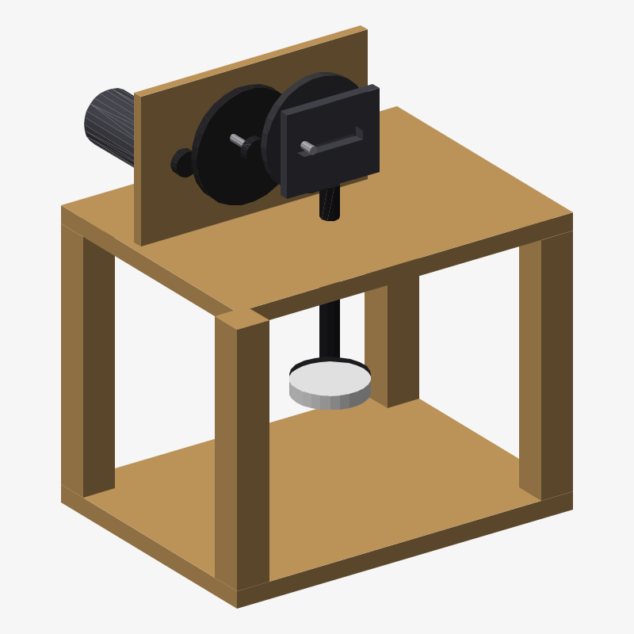

# CPRISEF: Hands Free CPR Compression Rig with AI Guidance

CPRISEF is a hands free CPR compression rig with AI guidance. A motor and a gearbox push a pad up and down at a steady 120 compressions a minute, a load cell feels every push, and a buzzer tells you when the pace slips.

With a scotch yoke that turns a spinning motor into a straight 50 mm push, and a Raspberry Pi Pico that watches the force, CPRISEF is a machine that never gets tired.

When someone collapses, good chest compressions have to start right away and stay at a steady pace. But rescuers get tired in about two minutes, their depth and rhythm drift, and most people doing CPR have never practiced. I wanted to see if a machine could hold the pace so the people around can call for help and focus on the rescue. Then I wanted to add an AI layer on top that tells the rescuer what to do next. I am doing this because it felt like a hardware problem that actually matters.

I am designing CPRISEF for ISEF and for Hack Club's Fallen. My build log is in [JOURNAL.md](JOURNAL.md).

CPRISEF is a science fair project and not a medical device. It only ever gets tested on a manikin or a force sensor, never on a person.

## Features

* 150 W DC motor with a two stage 25 to 1 spur gear reduction
* Scotch yoke that gives a straight 50 mm stroke at 120 compressions a minute
* About 500 N of peak force
* Load cell and HX711 amplifier that measure every compression
* Raspberry Pi Pico on a custom 70 by 70 mm interface board
* Buzzer and status LED that warn when the rate leaves the 100 to 120 per minute window
* Emergency stop input
* UART link to a Raspberry Pi 5 that will run the AI guidance
* Gears that I design and print myself

## Frame and mechanism

The whole rig is written in Python with CadQuery in cprisef.py, so I can change a number and rebuild everything. The frame is wood. The motor drives a two stage gearbox, the gearbox turns a crank, and the crank moves a scotch yoke that pushes the pad.

To rebuild the CAD:

    pip install -r requirements.txt
    python cprisef.py cprisef_rig.step
    python export_parts.py step

The first command writes the full assembly as one STEP file that opens in Onshape or any other CAD tool. The second writes one STEP file for every part. Both are already in the repo, in cprisef_rig.step and the step folder.

| Item | Value |
|---|---|
| Motor | 150 W DC, 3000 rpm, 12 V version |
| Gearbox | Two stage spur gears, 25 to 1 total |
| Gear module | 1.5, with 16 tooth and 80 tooth gears |
| Output speed | 120 compressions per minute |
| Mechanism | Scotch yoke, 25 mm crank radius |
| Stroke | 50 mm |
| Peak force | About 500 N |

## Gears

The gears are the one part I make myself. I design them in cprisef.py and print them in PETG. The rig peaks at about 500 N, so I will check how the printed teeth hold up before I trust them.

## PCB

The interface board connects the Pico to the HX711 load cell amplifier, the emergency stop input, a buzzer, a status LED and the UART link to the Pi. It is a 70 by 70 mm board with two layers, a ground pour on the bottom and four mounting holes. It carries no motor current, because the motor runs from a speed controller I buy ready made.

I generate the KiCad files and gerbers with pcb/make_pcb.py, then opened them in KiCad 7. The design rule check finds no errors once the ground zone is filled, which you do by pressing B in the PCB editor. KiCad only warns that the footprints are embedded instead of coming from a library. I have not ordered boards yet.

The KiCad project is in pcb/kicad and the fabrication files, including gerbers.zip, are in pcb/gerbers.

## Schematic and wiring

The schematic is in pcb/kicad/cprisef.kicad_sch.

## Firmware

The firmware runs on the Pico in MicroPython. It reads the load cell, finds each compression as a force peak, works out the rate, sounds the buzzer if the rate is off or the emergency stop is pressed, and sends the rate to the Raspberry Pi once a second. It is written for this board and has not run on real hardware yet.

Libraries used:

None. It only uses MicroPython's built in modules, json, time and machine.

Instructions:

1. Flash MicroPython onto the Pico. Hold the BOOTSEL button while you plug it in, then copy the .uf2 file over.
2. Open the Pico in Thonny.
3. Save firmware/main.py on the Pico as main.py.
4. Set COUNTS_PER_NEWTON and PEAK_FORCE using a known weight, since they need calibrating on the real rig.

## Parts

Everything is from Amazon, except the gears, which I print from filament. bom.csv has a link, a price estimate and an owned note for every item. The estimated total is about $685 before tax and shipping, and I own none of the parts yet. The camera for the AI stage is not in the list, because that stage comes later and I will get it myself.

## Files in this repo

| Path | What it is |
|---|---|
| cprisef.py | CAD source for the whole rig |
| cprisef_rig.step | The full assembly as one STEP file |
| step/ | One STEP file for each of the 14 parts |
| export_parts.py | Writes the STEP file for each part |
| pcb/kicad/ | KiCad project, schematic and board |
| pcb/gerbers/ | Gerbers, drill files and gerbers.zip |
| pcb/make_pcb.py | Script that generates the KiCad files and gerbers |
| firmware/main.py | MicroPython firmware for the interface board |
| bom.csv | Bill of materials |
| JOURNAL.md | Build journal |
| docs/ | The pictures used in this README |

## Safety and ethics

No human participants are involved. The rig is only tested on a manikin or a force sensor, never on a person. The motor circuit has a fuse and an emergency stop, and the emergency stop has to be rated for the motor current of about 12.5 A. Wiring the power cord to the supply involves mains voltage, so only someone who can do it safely should do it.

CPRISEF must never be used on a real patient. It follows the ISEF rules on safety, ethics, academic integrity and generative AI.

## Credits

The design that inspired this project is credited in my project paperwork. The CAD comes from cprisef.py with CadQuery, and the KiCad files and gerbers come from pcb/make_pcb.py.
