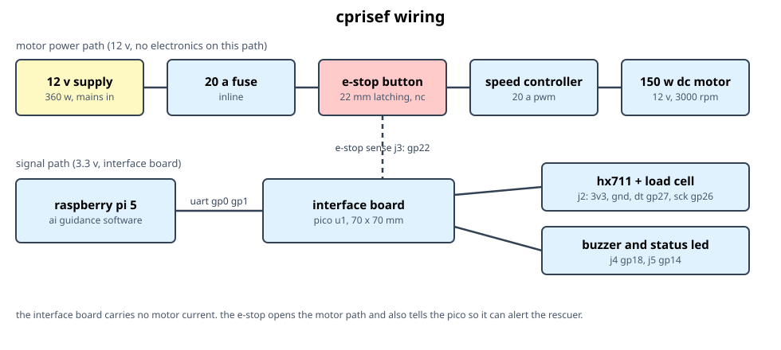

# cprisef

hi! cprisef is a hands free cpr compression rig with ai guidance. i am designing it for isef and building it for fallen at hack club, and this repo has everything for the design: the cad, the circuit board, the firmware and the parts list.

## why i made it

when someone collapses, good chest compressions have to start right away and stay at a steady pace. but rescuers get tired in about two minutes, their depth and rhythm drift, and most people doing cpr have never practiced. i wanted to see if a machine could hold the pace so the people around can call for help and focus on the rescue. then i wanted to add an ai layer on top that tells the rescuer what to do next. i am doing this because it felt like a hardware problem that actually matters.

## what it does

a 150 w motor drives a two stage gearbox, and a scotch yoke turns the spinning into a straight up and down push. the pad presses about 50 mm at 120 compressions a minute with around 500 n of force. a load cell measures every push, and a raspberry pi pico counts compressions, checks the rate, and beeps if it leaves the 100 to 120 per minute window or the emergency stop is hit. a raspberry pi 5 with a camera will run the ai guidance software, which is the next stage of the project.

it only ever gets tested on a manikin or a force sensor, never on a person.

## how to use this repo

the whole rig is written in python with cadquery, so you can rebuild the cad yourself.

    pip install -r requirements.txt
    python cprisef.py cprisef_rig.step
    python export_parts.py step

the first command writes the full assembly as a step file that opens in onshape or any other cad tool. the second writes one step file per part. both outputs are already in the repo too.

## files in this repo

| path | what it is |
|---|---|
| cprisef.py | parametric cad source for the whole rig |
| cprisef_rig.step | the full assembly as one step file |
| step/ | one step file for each of the 14 parts |
| export_parts.py | writes the per part step files |
| pcb/kicad/ | kicad project, schematic and board for the interface board |
| pcb/gerbers/ | gerbers, drill files and gerbers.zip for fabrication |
| pcb/make_pcb.py | script that generates the kicad files and gerbers |
| firmware/main.py | micropython firmware for the interface board |
| bom.csv | bill of materials with a link, a price estimate and an owned note for every item |
| docs/ | the pictures used below |

## screenshots

### full 3d assembly

### wiring diagram

### pcb

the interface board is a 70 by 70 mm two layer board. it connects the pico to the hx711 load cell amplifier, the emergency stop sense input, a buzzer, a status led and a uart link to the raspberry pi. it carries no motor current, because the motor runs from the off the shelf speed controller. the schematic is in pcb/kicad/cprisef.kicad_sch.

heads up: i generated the kicad files and gerbers with pcb/make_pcb.py and have not opened them in kicad or ordered boards yet, so i will run the design rule check before fabricating anything.

### firmware

firmware/main.py runs on the pico. it reads the load cell, counts compressions and their rate, sounds the buzzer when the rate is off or the emergency stop is pressed, and sends the rate to the raspberry pi once a second. it is written for this board and has not run on real hardware yet.

### 3d render

the assembly picture above is the render. the assembly source is cprisef.py, which is cadquery instead of fusion or freecad, and the electronics source is the kicad project in pcb/kicad.

## specifications

| item | value |
|---|---|
| motor | 150 w dc, 3000 rpm, 12 v version |
| gearbox | two stage spur gears, 25 to 1 total |
| gear module | 1.5, with 16 tooth and 80 tooth gears |
| output speed | 120 compressions per minute |
| mechanism | scotch yoke, 25 mm crank radius |
| stroke | 50 mm |
| peak force | about 500 n |
| frame | wood |

## parts and cost

everything is from amazon. bom.csv has a link for every item, and the estimated total is about 763 dollars before tax and shipping. those prices are my estimates, so i will check each one against its listing before ordering. bom.csv also says whether i already own each part, and right now i own none of them.

## safety and ethics

no human participants are involved. the rig is only tested on a manikin or a force sensor, never on a person. the motor circuit has a fuse and an emergency stop, and the emergency stop must be rated for the motor current of about 12.5 a. wiring the power cord to the supply involves mains voltage, so it should only be done by someone who can do it safely.

cprisef is a science fair project and not a medical device, so it must never be used on a real patient. it follows the isef rules on safety, ethics, academic integrity and generative ai, and the design that inspired it is credited in the project paperwork.
