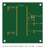

# CPRISEF: Hands-Free CPR Compression Rig with AI Guidance

CPRISEF is a motor-driven machine that does chest compressions at a steady pace, with a force sensor that checks every push and a buzzer that tells you when the rhythm is off. An AI guidance layer on a Raspberry Pi 5 is planned on top, to tell the rescuer what to do next.

When someone collapses, good chest compressions have to start right away and stay at a steady pace. But rescuers get tired in about two minutes, their depth and rhythm drift, and most people doing CPR have never practiced. I wanted to see if a machine could hold the pace so the people around can call for help and focus on the rescue. Then I wanted to add an AI layer on top that tells the rescuer what to do next. I am doing this because it felt like a hardware problem that actually matters.

I am designing it for ISEF and for Hack Club's Fallen. This repo has everything for the design: the CAD, the circuit board, the firmware and the parts list. My build log is in [JOURNAL.md](JOURNAL.md).

CPRISEF is a science fair project and not a medical device. It only ever gets tested on a manikin or a force sensor, never on a person.

## Features

- 150 W DC motor with a two-stage 25 to 1 spur gear reduction
- Scotch yoke that turns the spinning into a straight 50 mm push at 120 compressions a minute
- About 500 N of peak force
- Load cell and HX711 amplifier that measure every compression
- Raspberry Pi Pico on a custom 70 by 70 mm interface board
- Buzzer and status LED that warn when the rate leaves the 100 to 120 per minute window
- Emergency stop input
- UART link to a Raspberry Pi 5 that will run the AI guidance
- Gears that I design and 3D print, with the CAD written as Python so every dimension is a parameter

## CAD

The whole rig is written in Python with CadQuery in cprisef.py, so you can change a number and rebuild it. The frame is wood. The mechanism is a motor, a two-stage gearbox, a crank, a scotch yoke and a pad.

To rebuild it:

    pip install -r requirements.txt
    python cprisef.py cprisef_rig.step
    python export_parts.py step

The first command writes the full assembly as one STEP file that opens in Onshape or any other CAD tool. The second writes one STEP file per part. Both are already in the repo, in cprisef_rig.step and the step folder.

| Item | Value |
|---|---|
| Motor | 150 W DC, 3000 rpm, 12 V version |
| Gearbox | Two-stage spur gears, 25 to 1 total |
| Gear module | 1.5, with 16-tooth and 80-tooth gears that I designed and 3D print |
| Output speed | 120 compressions per minute |
| Mechanism | Scotch yoke, 25 mm crank radius |
| Stroke | 50 mm |
| Peak force | About 500 N |

## PCB

The interface board connects the Pico to the HX711 load cell amplifier, the emergency stop sense input, a buzzer, a status LED and the UART link to the Pi. It is a 70 by 70 mm two-layer board with a ground pour on the bottom layer and four mounting holes. It carries no motor current, because the motor runs from an off-the-shelf speed controller.

I generate the KiCad files and gerbers with pcb/make_pcb.py, then opened them in KiCad 7. The design rule check finds no errors once the ground zone is filled (press B in the PCB editor). KiCad only warns that the footprints are embedded instead of coming from a library. I have not ordered boards yet.

The KiCad project is in pcb/kicad and the fabrication files, including gerbers.zip, are in pcb/gerbers.

## Schematic and wiring

The schematic is in pcb/kicad/cprisef.kicad_sch.

## Firmware

firmware/main.py runs on the Pico in MicroPython. It reads the load cell, finds each compression as a force peak, works out the rate, sounds the buzzer if the rate is off or the emergency stop is pressed, and sends the rate to the Raspberry Pi once a second. It is written for this board and has not run on real hardware yet. The force threshold and the load cell scale need calibrating on the real rig.

It only uses MicroPython's built-in modules (json, time and machine), so there is nothing extra to install.

Instructions:
1. Flash MicroPython onto the Pico (hold BOOTSEL while plugging it in, then copy the .uf2 file).
2. Open the Pico in Thonny.
3. Save firmware/main.py on the Pico as main.py.
4. Calibrate COUNTS_PER_NEWTON and PEAK_FORCE against a known weight.

## Parts

Everything is from Amazon, except the gears, which I print from filament. bom.csv has a link, a price estimate and an owned note for every item. The estimated total is about $685 before tax and shipping, and I own none of the parts yet. The camera for the AI stage is not in the list, because that stage comes later and I will source it myself.

## Files in this repo

| Path | What it is |
|---|---|
| cprisef.py | Parametric CAD source for the whole rig |
| cprisef_rig.step | The full assembly as one STEP file |
| step/ | One STEP file for each of the 14 parts |
| export_parts.py | Writes the per-part STEP files |
| pcb/kicad/ | KiCad project, schematic and board |
| pcb/gerbers/ | Gerbers, drill files and gerbers.zip |
| pcb/make_pcb.py | Script that generates the KiCad files and gerbers |
| firmware/main.py | MicroPython firmware for the interface board |
| bom.csv | Bill of materials |
| JOURNAL.md | Build journal |
| docs/ | The pictures used in this README |

## Safety and ethics

No human participants are involved. The rig is only tested on a manikin or a force sensor, never on a person. The motor circuit has a fuse and an emergency stop, and the emergency stop must be rated for the motor current of about 12.5 A. Wiring the power cord to the supply involves mains voltage, so it should only be done by someone who can do it safely.

CPRISEF must never be used on a real patient. It follows the ISEF rules on safety, ethics, academic integrity and generative AI.

## Credits

The design that inspired this project is credited in the project paperwork. The KiCad files and gerbers are generated by pcb/make_pcb.py, and the CAD is generated by cprisef.py with CadQuery.
